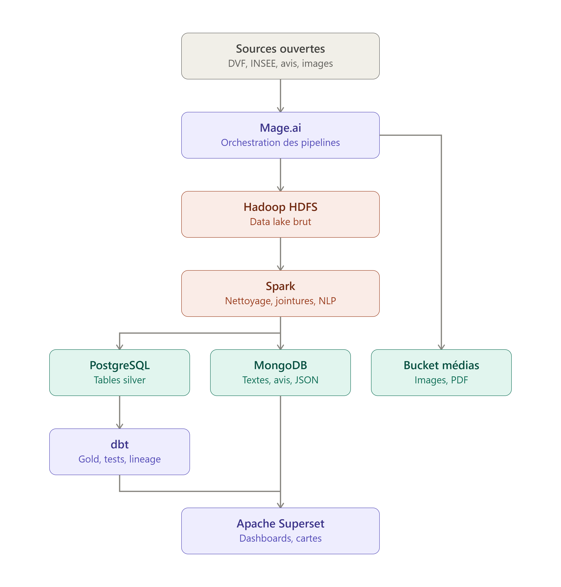

# HOMEPEDIA — plateforme big data pour les constructeurs de bunkers

Projet d'école : croiser des **sources de données ouvertes** pour aider les entreprises de construction
et de rénovation de bunkers à qualifier des terrains.

**Question métier du premier jet :** *quelles parcelles cadastrales sont proches d'une cavité souterraine
connue (carrière, grotte, ouvrage militaire…) ?* Une cavité proche est soit un **risque** (effondrement),
soit une **opportunité** (ouvrage existant à réhabiliter).

Résultat : un tableau de bord Superset avec une carte (parcelles + cavités), le % de parcelles exposées
par commune, le nombre de parcelles à moins de 200 m d'une cavité, une **galerie** (photo aérienne +
description de chaque cavité) et les **mots-clés** trouvés dans les descriptions, filtrables par commune.

---

## Architecture



```
 Sources ouvertes                 Mage (orchestrateur) : pipeline homepedia_full, lancé chaque lundi
 ─────────────────                ────────────────────────────────────────────────────────────────
 Cadastre Etalab ─┐
                  ├─> [bronze] HDFS ──> [silver] Spark ──> PostgreSQL ──> [gold] dbt ──> Superset
 BD Cavités BRGM ─┘   JSON brut        nettoie, type,     schéma silver   PostGIS :     tableau
                      /bronze/...      dédoublonne                        distances,    de bord
                                          │                               tests            ▲
                                          ├──> MongoDB : fiches complètes ─(mots-clés)─────┤
                                          │    (texte libre, recherche plein texte)        │
 Photos aériennes IGN ──── Mage ──> bucket S3 "medias" (SeaweedFS) ─(chemins en base)──────┘
```

Deux familles de stockage en plus des tables :
- **MongoDB** (base *documentaire*) : la fiche complète de chaque cavité, en document JSON imbriqué,
  avec son texte libre ; index plein texte (français) et géographique.
- **Bucket S3 `medias`** (SeaweedFS, stockage *d'objets*) : les fichiers (photos). La base ne garde
  que leur chemin (`silver.medias`). Superset ne lit ni MongoDB ni S3 directement : les résultats
  utiles sont préparés dans Postgres (gold).

| Couche | Où | Contenu | Écrit par |
|---|---|---|---|
| 🥉 **bronze** | HDFS `/bronze/<source>/dep=<dép>/ingest_date=<jour>/` | Données brutes, une ligne JSON par objet, jamais modifiées | Mage |
| 🥈 **silver** | PostgreSQL, schéma `silver` | Tables propres et typées, une ligne par parcelle / cavité | Spark (+ Mage pour `perimetre_communes`) |
| 🥇 **gold** | PostgreSQL, schéma `gold` | Réponses métier, testées et documentées | dbt |

### Le trajet d'une parcelle (exemple : `57704000010142`, à Veckring)

1. **Mage** télécharge `cadastre-57704-parcelles.json.gz` (Etalab), le découpe en une ligne par parcelle
   et l'écrit dans HDFS : `/bronze/cadastre/dep=57/ingest_date=.../57704.jsonl`.
2. **Spark** lit HDFS, met à plat les champs (`properties.contenance` → `contenance_m2` entier…),
   garde la version la plus récente de chaque parcelle et écrit `silver.parcelles`.
3. **dbt** transforme le contour GeoJSON en géométrie PostGIS en Lambert-93 (mètres) (`stg_parcelles`),
   compte les cavités à moins de 200 / 500 m grâce à un index spatial, et classe la parcelle
   (`gold.parcelles_exposition_cavites` : 2 350 m², cavité la plus proche à 536 m → exposition « aucune »).
4. **Superset** lit les tables gold et affiche la parcelle sur la carte, dans les barres et le chiffre clé.

---

## Démarrer le projet

### Prérequis
- **Docker Desktop** avec **au moins 7 Go de RAM** alloués (Settings → Resources → Memory).
- Environ 10 Go de disque libre (images Docker).

### Premier lancement

```bash
# 1. Secrets : copier le modèle puis remplacer chaque "change-moi"
cp .env.example .env
#    SUPERSET_SECRET_KEY : générer avec   openssl rand -base64 42

# 2. Construire les images et démarrer les 11 services (5 à 10 min la 1re fois)
docker compose up -d --build

# 3. Remplir les données une première fois (~5 min : photos) — ensuite, automatique chaque lundi
docker compose exec mage mage run homepedia homepedia_full
```

Puis ouvrir le tableau de bord : http://localhost:8088/superset/dashboard/cavites-parcelles/ (ou **Dashboards → Cavités & parcelles**).

### Où regarder

| Interface | URL | Identifiants | À quoi ça sert |
|---|---|---|---|
| **Superset** | http://localhost:8088 | `admin` / `SUPERSET_ADMIN_PASSWORD` du `.env` | Tableaux de bord, SQL Lab |
| **Mage** | http://localhost:6789 | `admin@admin.com` / `admin` | Pipelines, blocs, logs, triggers |
| **dbt docs** | http://localhost:8081 | — | Doc des tables, graphe de lignage (bouton en bas à droite) |
| **HDFS** | http://localhost:9870 | — | État du data lake ; *Utilities → Browse the file system* |
| **Spark** | http://localhost:8080 | — | Workers, applications en cours / terminées |
| **PostgreSQL** | `localhost:5432`, base `homepedia` | `POSTGRES_USER` / `POSTGRES_PASSWORD` du `.env` | Client SQL (DBeaver, pgAdmin…) |
| **mongo-express** | http://localhost:8082 | `MONGO_EXPRESS_USER` / `MONGO_EXPRESS_PASSWORD` du `.env` | Parcourir MongoDB : base `homepedia`, collection `cavites_fiches` |
| **SeaweedFS (admin)** | http://localhost:23646 | `admin` / `SEAWEEDFS_ADMIN_PASSWORD` du `.env` | Parcourir le bucket `medias` |
| **Bucket S3** | http://localhost:8333/medias/&lt;clé&gt; | lecture libre ; écriture : `S3_ACCESS_KEY` / `S3_SECRET_KEY` | Les photos, ex. `orthophotos/57704/LORAW0005856.jpg` |

---

## Tâches courantes

### Ajouter une commune… ou un département entier
Dans [`config/perimetre.yml`](config/perimetre.yml), puis relancer `homepedia_full`
(Mage → *Pipelines → homepedia_full → Triggers → Run @once*). Rien d'autre à modifier.

```yaml
departements:
    - "69"          # toutes les communes du Rhône (liste lue sur geo.api.gouv.fr)
```

```yaml
  - insee: "69233"            # code INSEE (≠ code postal), TOUJOURS entre guillemets
    nom: Saint-Romain-au-Mont-d'Or
```
Trouver un code INSEE : `https://geo.api.gouv.fr/communes?nom=<nom>&fields=code,nom,codeDepartement`
(vérifier le résultat : la recherche « Metz » renvoie d'abord *Metzing*).
Paris, Lyon, Marseille : utiliser les codes des **arrondissements** (Lyon 1er = `69381`…).

### Lancer une seule étape
| Pipeline Mage | Fait | Durée |
|---|---|---|
| `homepedia_full` | tout, dans l'ordre (13 blocs, dont MongoDB, photos et rétention) | ~10 min (+ ~3 min pour les photos d'un nouveau territoire) |
| `ingest_bronze` | téléchargement → HDFS (commune par commune, en flux) | ~7 min |
| `run_spark_clean` | HDFS → silver (3 jobs Spark) | ~2 min |
| `build_gold` | silver → gold (`dbt build`, 50 tests) + doc | ~2 min 20 |

Durées mesurées sur le périmètre actuel : **280 communes (Rhône entier + 6 communes de Moselle),
~1 million de parcelles**. Pour 9 communes (87 000 parcelles), `homepedia_full` prenait ~2 min.

En ligne de commande : `docker compose exec mage mage run homepedia <pipeline>`.

### Historique du bronze (rétention)
HDFS garde une ingestion par exécution. Le bloc `retention_bronze` (juste après l'ingestion) ne garde
que les **4 dernières** par source et département ; réglage : `RETENTION_BRONZE_INGESTIONS` dans
`docker-compose.yml` (service `mage`).

### Passer en cluster sur plusieurs PC
Plan pas à pas (réseau privé Tailscale, 2e worker Spark, 2e DataNode HDFS) : [`docs/PLAN_CLUSTER.md`](docs/PLAN_CLUSTER.md).

### Modifier le tableau de bord
1. Le modifier dans l'interface Superset et enregistrer.
2. L'exporter dans le projet : `./docker/superset/exporter_dashboard.sh`
3. `docker compose build superset` (le dossier `docker/superset/dashboard/` est embarqué dans l'image).

Au démarrage, Superset importe ce dossier **seulement si le dashboard n'existe pas** : les modifications
faites dans l'interface ne sont jamais écrasées. Pour forcer : `SUPERSET_FORCE_IMPORT=1 docker compose up -d superset`.

### Ajouter un modèle dbt
Créer un `.sql` dans `mage/homepedia/dbt/homepedia_dbt/models/gold/` (utiliser `{{ ref(...) }}` /
`{{ source(...) }}`), le documenter et le tester dans `_gold.yml`, puis lancer `build_gold`.
Pour qu'il apparaisse dans Superset : l'ajouter à `TABLES_GOLD` dans `docker/superset/init_datasets.py`
(ou *Datasets → + Dataset* dans l'interface).

---

## Structure du dépôt

```
config/perimetre.yml            ← LA configuration : liste des communes étudiées
docker-compose.yml              ← les 11 services
.env.example                    ← modèle des secrets (.env n'est jamais commité)
docker/
  hadoop/                       ← image HDFS + configuration (hadoop.env)
  seaweedfs/demarrage.sh        ← stockage S3 : droits d'accès (Mage écrit, le navigateur lit)
  mage/Dockerfile               ← Mage + Java + client HDFS + pyspark (virtualenv séparé)
  superset/                     ← image Superset, démarrage, dashboard versionné (dashboard/)
mage/homepedia/                 ← projet Mage
  pipelines/                    ← homepedia_full, ingest_bronze, run_spark_clean, build_gold
  data_loaders/ transformers/ data_exporters/ custom/   ← les blocs
  utils/                        ← téléchargement HTTP avec relances, lancement de Spark
  dbt/homepedia_dbt/            ← projet dbt : sources, staging, gold, tests
spark/jobs/                     ← jobs Spark bronze → silver
sql/init/                       ← initialisation Postgres (PostGIS, schémas, table silver.medias)
docs/fiches-sources/            ← une fiche par source : accès, champs, pièges
PLAN_PREMIER_JET.md             ← plan d'origine + écarts réalisés
```

---

## Dépannage

| Symptôme | Cause | Solution |
|---|---|---|
| Une modification de fichier n'est pas prise en compte par Mage (bloc ignoré, ancien code exécuté) | Docker Desktop (Linux) ne voit pas un fichier **remplacé** (nouvel inode) tant que le conteneur tourne. Une écriture sur place (VS Code) passe. | `docker compose restart mage` |
| Un bloc Spark échoue : « Aucun worker Spark enregistré » | Après une mise en veille, le master Spark a « oublié » le worker | `docker compose restart spark-worker` |
| Un job Spark reste en `WAITING` | Idem, ou pas assez de RAM pour Docker | Idem ; vérifier http://localhost:8080 (1 worker, 2 cœurs) |
| Écriture HDFS refusée juste après le démarrage | Le NameNode est en *safe mode* le temps que le DataNode se présente | Attendre ~30 s (`docker compose exec namenode hdfs dfsadmin -safemode wait`) |
| Graphiques Superset vides | Tables gold pas encore construites | Lancer `homepedia_full` |
| La carte n'affiche qu'une commune | Voulu : le filtre Commune est obligatoire (~1 million de parcelles au total, trop pour un navigateur) | Choisir la commune dans le panneau de filtres à gauche |
| Un test dbt échoue | Donnée incohérente : dbt arrête la chaîne avant de publier un gold faux | Lire le test en échec dans les logs du bloc `run_dbt_build` |
| Un test dbt ajouté n'est jamais exécuté (nombre de tests qui baisse) | Cache d'analyse de dbt périmé | Déjà contourné : `--no-partial-parse` dans le bloc `run_dbt_build` ; en ligne de commande, ajouter cette option |
| Les photos ne s'affichent pas dans Superset | Le navigateur bloque les images d'une adresse non autorisée (CSP) | `S3_URL_PUBLIQUE` doit correspondre à l'adresse du bucket vue par le navigateur (défaut `http://localhost:8333`) |
| Commune ajoutée absente de la carte, ou sans cavité | Code INSEE de ville entière (Lyon `69123`) ou cavités confidentielles | Voir `docs/fiches-sources/` |

---

## Sources

| Source | Producteur | Licence | Fiche |
|---|---|---|---|
| Cadastre — parcelles | DGFiP / Etalab | Licence Ouverte 2.0 | [cadastre-parcelles.md](docs/fiches-sources/cadastre-parcelles.md) |
| Inventaire des cavités souterraines (BD Cavités) | BRGM / Géorisques | Licence Ouverte (à confirmer) | [cavites-bdcavites.md](docs/fiches-sources/cavites-bdcavites.md) |
| Codes et noms de communes | geo.api.gouv.fr | Licence Ouverte 2.0 | — |
| Photos aériennes (BD ORTHO, service WMS) | IGN / Géoplateforme | Licence Ouverte 2.0 | — |

## Versions

PostgreSQL 17 + PostGIS 3.5 · Mage 0.9.79 · Hadoop 3.4.3 · Spark 4.1.3 (Java 17, Python 3.10) ·
dbt-core 1.8.7 + dbt-postgres 1.8.2 · Superset 6.1.0 · MongoDB 8.0.32 (+ connecteur Spark 11.1.0) ·
mongo-express 1.0.2 · SeaweedFS 4.47
